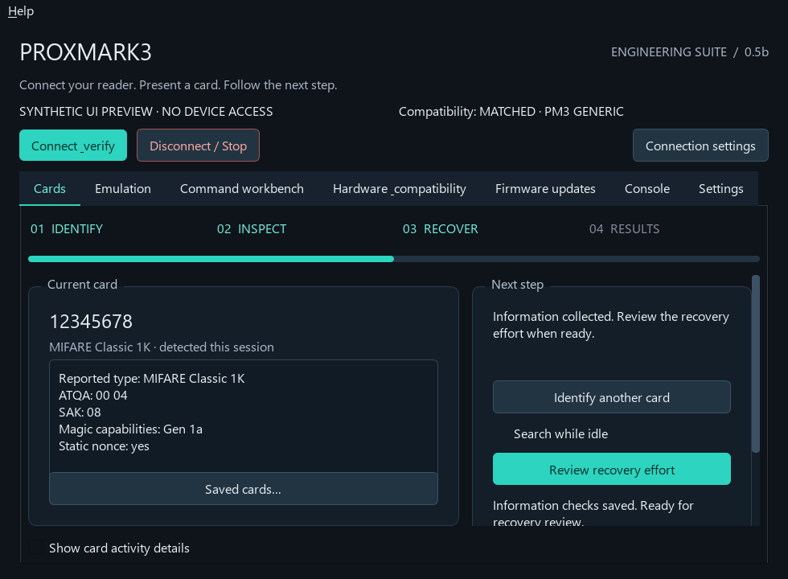
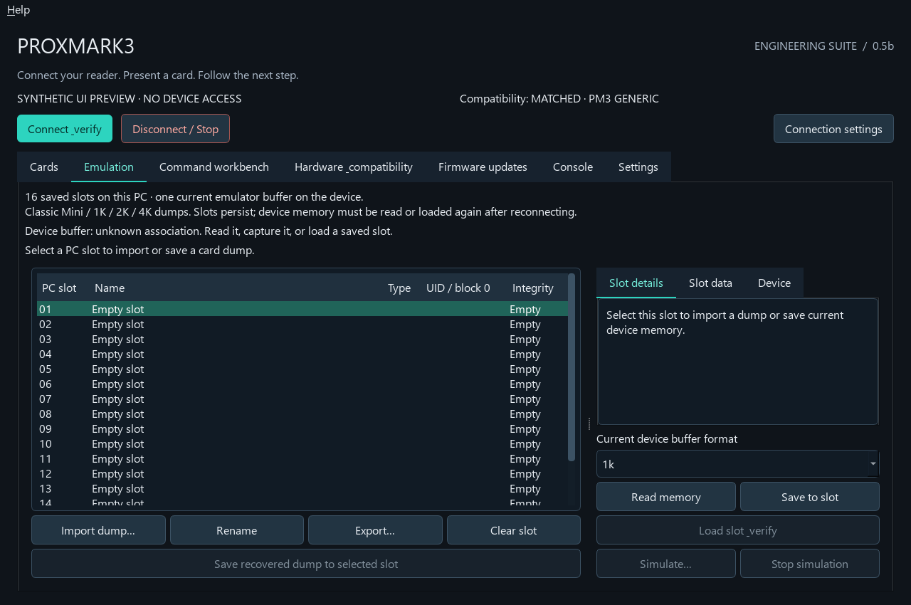
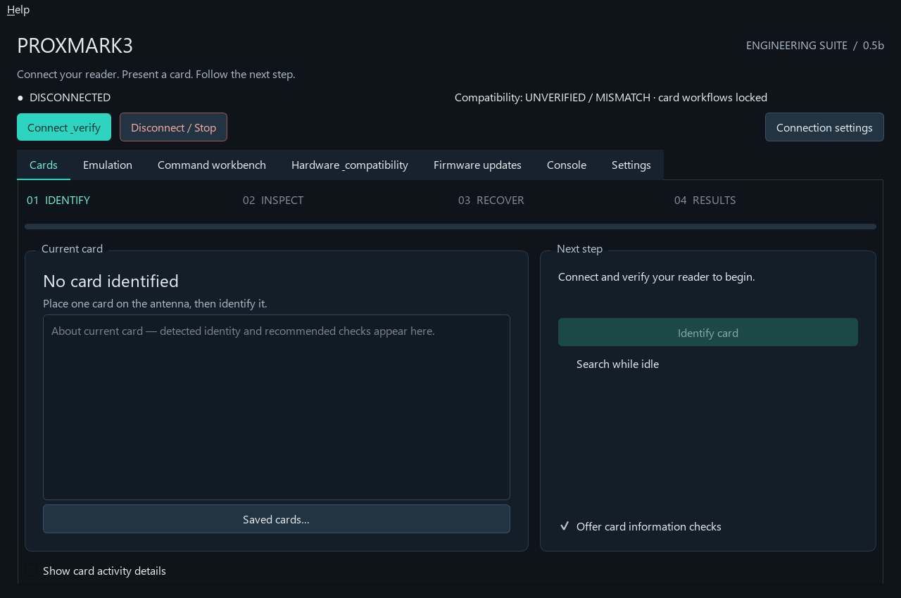

# Proxmark3 Easy GUI — by Justin

A Windows app for identifying LF/HF cards, exploring Proxmark3 commands, collecting card information and managing saved MIFARE Classic dumps. The app is named **Proxmark3 Engineering Suite** on your Desktop.

**Current release: 0.5b beta** · [Download Windows installer](https://github.com/Anon0ne/Proxmark3-Easy-GUI-by-Justin/releases/download/v0.5b/Proxmark3-Easy-GUI-0.5b-Setup.exe) · [All downloads and release notes](https://github.com/Anon0ne/Proxmark3-Easy-GUI-by-Justin/releases/tag/v0.5b)

## Get started

You need Windows 10/11, a Proxmark3 Easy with its USB driver, and a compatible installed Iceman/RRG Windows client. **The installer includes the app's Python and GUI dependencies**; you do not need Python to use it. The Iceman client and firmware are separate.

1. Download and run **Proxmark3-Easy-GUI-0.5b-Setup.exe**. It installs for your Windows account and creates Desktop and Start menu shortcuts. Alternatively, extract the portable Windows ZIP and run `Proxmark3Suite.exe`.
2. Connect your Proxmark3 Easy by USB. Close any other Proxmark3 client using its COM port.
3. Open **Proxmark3 Engineering Suite**, then **Connection settings**. Select your existing `pm3.bat` or client EXE and the device's COM port.
4. Click **Connect & verify**. The app discovers your client's commands and checks device compatibility. Review any mismatch in **Hardware & compatibility** before continuing.
5. Open **Cards**, place one card on the appropriate antenna, and click **Identify card**.

The configured defaults are `C:\rrg_other\pm3.bat`, **COM18**, **PM3 GENERIC / Easy**, and Iceman revision **v4.21611-636-gda509461b**. Choose the port assigned to your reader; COM18 is the tested local setup.

## Identify a card and collect information



The **Cards** tab guides you through identification, information checks and recovery. The current-card section keeps useful facts reported by the client—such as UID, card type, ATQA, SAK, magic capabilities and nonce information—separate from the full console output. **Saved cards…** opens your saved observations, which remain after the current card is removed.

- Click **Identify card** for an LF/HF search, or enable **Search while idle** to search periodically when no other operation is running.
- Follow **Next recommended step** to review information checks. For an identified MIFARE Classic card, these can include UID reading and `hf mf info`.
- Keep the card still while checks run. The activity bar and elapsed time show the workflow's state; they do not predict how long recovery will take.
- Review **Auto Recovery** when offered. The app asks for separate permission and rechecks the UID before using the installed client's `hf mf autopwn` workflow.
- Inspect the results and any saved dump. Recovery can fail or find only some keys; a completed command does not prove complete recovery.

Recovery is currently guided for recognized **MIFARE Classic** cards. Other technologies remain accessible through the command workbench. The app does not provide universal automatic card decryption. Card writes and potentially destructive operations require explicit confirmation.

## Save and inspect emulated cards



The **Emulation** tab provides **16 persistent PC slots** for MIFARE Classic Mini, 1K, 2K and 4K dumps. Import BIN, EML or supported Iceman MFC JSON files; name a slot, inspect its blocks, export it, or save a suitable recovered dump when offered.

PC slots are your saved library. The Proxmark3 has **one current emulator buffer** in this managed workflow; loading a different slot replaces that buffer.

1. Select a slot and import a dump, or save a recovered dump to it.
2. Review **Slot details** and **Slot data**, including size, integrity and access-bit warnings.
3. To inspect the device, choose the correct card size and use **Read memory** or **Save to slot**.
4. **Load slot & verify** asks permission, loads the buffer and compares its readback with the saved dump.
5. **Simulate…** asks for separate permission and checks the buffer again before starting simulation. Use **Stop simulation** to end it.

Loading and RF simulation are implemented but have not yet been verified on physical hardware. Starting simulation does not prove successful interaction with a reader. See the [emulation guide](Proxmark3Suite/EMULATION.md) for supported formats, controls and device limits.

## Explore commands without memorizing their syntax



The **Command workbench** builds its searchable tree from your selected client's documentation. Search command names and descriptions, expand a group, or double-click an entry to select it. Argument forms use documented switches, value fields and dropdown choices where the client defines them.

Read the help and examples, fill in the required values, then review the exact command preview before running it. Favorites and history make repeat tasks quicker. **Ctrl+K** focuses search; **Ctrl+Enter** runs the selected command.

The verified target client exposes **989 commands and 3,716 options**. Your catalog follows your installed client. A command appearing in the catalog does not guarantee that your board supports its required hardware capabilities. Complex syntax and card-specific values still need your review; the app does not invent keys or unsupported arguments.

## What each tab does

| Tab | Use it for |
| --- | --- |
| **Cards** | Read-only LF/HF identification, current-card facts, saved observations, information checks and separately approved Classic recovery. |
| **Emulation** | Saved PC slots, dump inspection, import/export, device memory capture, confirmed loading and simulation controls. |
| **Command workbench** | Searchable firmware commands, argument forms, exact help, command previews, favorites and history. |
| **Hardware & compatibility** | Device version, status and ping diagnostics; client/firmware/model compatibility checks. |
| **Firmware updates** | Prepare latest or named RRG revisions, build for Generic Easy, review artifacts and confirm flashing. Requires a configured ProxSpace toolchain. |
| **Console** | Live client output, command results and output export. Local session logs rotate automatically. |
| **Settings** | Client path, COM port and connection configuration. |

The top **Help** menu includes getting started, card positioning, recovery, troubleshooting and emulation guidance. The client stays connected between commands, and operations are serialized to avoid competing device requests.

## Common questions

**The app cannot connect.** Check the USB connection, driver and selected COM port. Close other clients using the reader, then reconnect.

**A card was found, but the next command says “No tag.”** Keep it on the antenna and adjust its distance or position slightly. Repeat identification before retrying information checks or recovery.

**Compatibility checks fail.** Review the client and device revisions in Hardware & compatibility. Use a matching client/firmware pair; device workflows remain locked when compatibility is unverified or mismatched.

**Where are my saved cards and slots?** They are stored in the app's per-user data directory, separately from the EXE. Upgrades and the Windows uninstaller preserve that data. Logs, dumps and exported observations can contain card identifiers and keys.

**Do I need to build anything?** No. Use the Windows Setup installer or portable ZIP. Source setup is only needed if you want to develop or rebuild the app.

## Beta status

**Verified:** 48 automated tests; installer and installed EXE startup on the development PC; command discovery; earlier physical COM18 hardware diagnostics, card identification, matching authenticated card backups, and read-only emulator viewing/capture with PC-slot matching.

**Still unverified end to end:** successful physical autopwn recovery, card writing, device emulator loading, RF simulation/reader interaction, latest firmware compilation/flashing, clean-machine installation and the Python-missing source setup path. The EXE and installer are unsigned.

See the [verification record](Proxmark3Suite/VERIFICATION.md), [release notes](RELEASE_NOTES.md) and [detailed usage and firmware guide](Proxmark3Suite/README.md). Screenshots above are illustrative GUI previews, not evidence of hardware operations.

See [Future Features](Proxmark3Suite/FUTURE_FEATURES.md) for researched additions and their priorities. These are separate from the features shipped above.

## For developers

To build from source, open the `Proxmark3Suite` folder and run:

```powershell
powershell -NoProfile -ExecutionPolicy Bypass -File .\install_windows.ps1
```

The source installer checks Python, installs dependencies, runs tests, builds the EXE and creates a shortcut. See the [developer and firmware instructions](Proxmark3Suite/README.md) for build details. To report a problem, [open an issue](https://github.com/Anon0ne/Proxmark3-Easy-GUI-by-Justin/issues) with the app version, client/firmware revision, steps and relevant output; remove private card data before posting.

Copyright Justin. A redistribution license has not yet been selected. The client-help fixture originates from Iceman/RRG Proxmark3; upstream materials retain their applicable notices and license.
